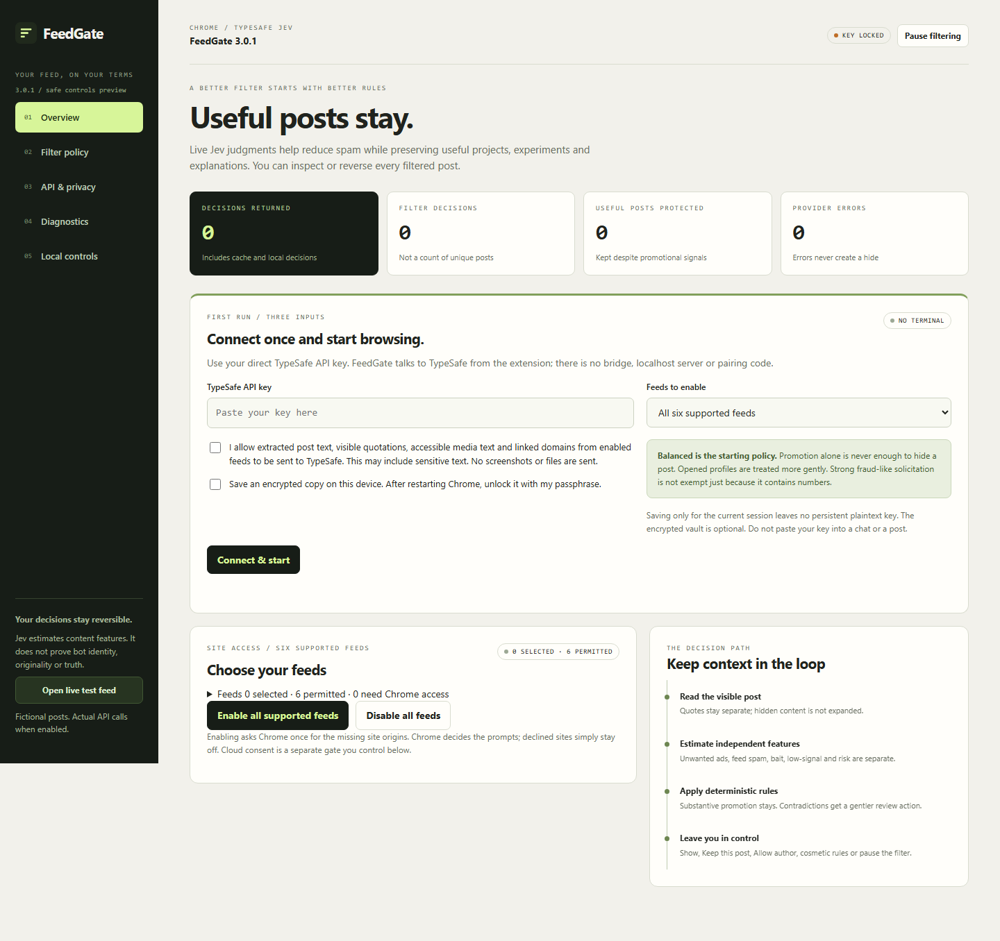

# FeedGate 3.0.1

A Chrome extension that uses TypeSafe Jev to reduce feed noise without hiding ordinary organic content. A post being promotional is not treated as a reason to filter it. Filtering is reversible, the rules are explicit, and the API key is entered inside the extension.

**Personal-use preview. No terminal, bridge, pairing code or external server is required.**



## Install the ready-made extension

Extract the release into a permanent folder. Open `chrome://extensions`, enable Developer mode, choose **Load unpacked**, and select the `extension` directory containing `manifest.json`.

In FeedGate, enter a direct TypeSafe API key, grant cloud-analysis consent, and click **Connect & start** with **All six supported feeds** preselected. Chrome asks once for the selected origins. The extension tests one fictional post with the actual API before enabling the selected feeds. Refresh existing tabs, especially after removing an older FeedGate build.

The ready-made extension does not need Node, Python, npm, a local service, or an installer executable. Chrome 120 or later is declared in the manifest. Managed browsers may prohibit unpacked extensions; do not work around administrator policy.

For a short step-by-step walkthrough, open [START_HERE.html](START_HERE.html), [START_HERE.md](START_HERE.md) or the Polish [START_TUTAJ_PL.md](START_TUTAJ_PL.md). Upgrading from 2.x: read [docs/MIGRATION.md](docs/MIGRATION.md).

## What changed in 3.0

Version 3.0 keeps the 2.1.1 filtering semantics and adds local control, safety and coverage:

* **A status panel with real modes.** The on-page status starts as a small pill, expands into controls, or can be hidden completely. Hiding the panel never pauses filtering, the choice survives restarts, and a hidden panel is not recreated unless you change the setting. Errors surface in the popup instead.
* **Complete recovery for any page.** **Restore this site** saves a pause *first* in the trusted worker, then asks open tabs to remove their effects with a bounded timeout. If a tab never responds, the pause still holds and you get an explicit **Reload this tab with filtering paused** option. Restarting the browser cannot resurrect hidden content.
* **Transactional element picker.** Picking an element now previews before anything is saved: scope, match count and what would hide. Structural targets (page roots, navigation, the main content column, multi-item containers, FeedGate's own UI) and match sets that would hide most of the page are rejected. Commit re-validates the live node, and every commit offers a 15-second Undo plus a persistent Undo in the popup.
* **Managed cosmetic filters.** Rules are real records with stable ids, a status (`active`, `quarantined`, `disabled`, `deleted`), a concise reason and per-domain revision checks. The options page lists them with Enable, Disable, Edit, Delete, **Undo deletion**, bulk disable and confirmed bulk delete. Selectors stay local and never appear in diagnostic exports.
* **Legacy rules cannot hide anything at startup.** Cosmetic CSS from earlier versions becomes **quarantined** with the reason `legacy_unvalidated`. A rule is re-checked against the current safety rules and only activates after a real matching element is observed.
* **Loop containment.** One controller per document, coalesced scheduling, unchanged decisions are no-ops, self-authored mutations are ignored for extraction and model work, and a bounded circuit breaker quarantines a rule that keeps rewriting the page.
* **Wykop (beta).** Public Główna/Wykopalisko lists, Mikroblog entries, tag streams and profile/detail pages are supported through the same pipeline. Link cards and entries stay distinct, comments and replies are excluded, and Wykop's informational "Wykop Poleca" note or old promotion text can never trigger local ad hiding.
* **Honest feed registry.** One registry drives selection, permissions, registration and diagnostics. The feeds list shows desired, permitted and effective states with plain reasons, and **Enable all supported feeds** requests the missing origins in a single logical prompt.
* **Diagnostics schema 5.** Exports separate semantic, cosmetic and UI metrics, include a build fingerprint and per-site states, and prove renderer health with heartbeats instead of assuming silence means zero activity.

## What changed in 2.1

Version 2.0 already separated promotion from hiding rules, but its diagnostics showed that one ambiguous category still did most of the work, and the rubric sent roughly a thousand input tokens per classified post. Version 2.1 is precision-first:

* **Promotion is never enough.** High promotional intent alone keeps the post visible. An unwanted-advertising estimate collapses a post only when feed-spam signals are also high and both usefulness estimates are low.
* **Clearer categories.** The policy now names *Unwanted advertising*, *Feed spam*, *Manipulative engagement bait*, *Low-signal filler* and *Risk or scam-like content* as separate estimates. "Promotion" is no longer a filtering category and no longer looks inherently bad in the interface.
* **Explicit protection indicators.** *Useful information* (>= 0.65) or *Original contribution* (>= 0.70) keeps a post visible ahead of the advertising, bait and low-signal rules. Only risk, an explicit custom exclusion or overwhelmingly strong spam evidence (>= 0.98) can override protection.
* **Smaller requests.** The shared instruction and the eight question texts were rewritten without changing their meaning, cutting the instruction payload by about 38% (roughly 2,900 to 1,800 characters). The per-post request now targets a few hundred input tokens instead of about a thousand.
* **Rule names in evidence.** Every decision records an explicit rule such as `unwanted_ad_low_value`, `feed_spam`, `useful_or_original_protection` or `promotion_signal_alone`, alongside the scores, protection flag, sufficiency estimate, cache status, model and latency.
* **No stale semantics.** The rubric id is now `feed-v2.1.0` and the cache namespace changed. Cached 2.0 judgments and 2.0 thresholds are ignored, and the old promotion threshold is deliberately **not** mapped onto the new unwanted-advertising category.

Balanced, Aggressive, Observe Only and Custom presets expose the same deterministic rules. Opened profiles normally receive gentler semantic filtering. Visible quotes are separated from the main author's words, and truncated posts are treated more cautiously. No author reputation is inferred, no account is automatically blacklisted, and no attempt is made to prove that someone is a bot.

### What changed in 2.1.1

The 2.1.1 repair removes the remaining ways an ordinary post could be hidden by local ad detection:

* **Structured ad evidence.** Local ad detection now returns a structured evidence object (`verified`, `ambiguous` or `none`) with a marker kind, selector id, ownership, rendered-label flag, evidence kind and scope. Only a verified rendered or platform-metadata label owned by the outer post can collapse it locally.
* **No guessing from neighbouring markup.** Impression or placement tracking wrappers, words like "Sponsored" in post text, names, links, media alt text or unrelated accessibility labels, labels hidden in templates, and badges that belong to a quoted or adjacent card can no longer mark the outer post.
* **Legacy flags are downgraded.** Boolean ad flags stored by 2.0 or 2.1.0 are migrated to `ambiguous`, so they continue through the semantic path instead of collapsing locally.
* **Truthful reasons.** `promotion_signal_alone` is reported only when no other noise estimate (feed spam, bait, risk) is elevated. Mixed below-threshold signals are reported as `below_noise_thresholds`.
* **Marginally useful content keeps its conflict branch.** Protection eligibility now starts at `useful >= 0.65` or `original >= 0.70` (an engineering choice), and every decision records `protectionEligible` separately from the applied `protected` flag.
* **Separate version ids.** The release, semantic rubric, policy, ad detector, extraction and diagnostics schema are versioned independently, and the diagnostics export includes a build fingerprint. Open tabs working with an outdated content script show a reload prompt instead of mixing schemas.
* **Reddit title duplication fixed.** The post title is no longer prepended twice.

The policy thresholds were not lowered, Low-signal filler remains off by default, and the sufficiency guard is unchanged.

**Show** temporarily restores a post. **Keep this post** stores a local hash-based exception for that particular visible post. **Allow author** is a deliberate, platform-specific exception. **Alt + Shift + F** reveals or refilters the current page. Explicit CSS rules and a small element picker remain available for local cosmetic filtering.

The on-page status panel and Diagnostics screen separate detection, pending work, returned judgments, local cosmetic actions and filtering. **Export diagnostics** produces a structured JSON file without keys, vault ciphertext, post text, authors, custom rule text, raw cosmetic selectors, stored post hashes or full browsing URLs. Recovery steps are documented in [docs/RECOVERY.md](docs/RECOVERY.md).

## Architecture

```text
Enabled feed
  -> isolated content script
  -> visible text and quote extraction
  -> extension service worker
       -> explicit local rule / user exception
       -> score cache and request queue
       -> direct TypeSafe HTTPS request
       -> strict Noul response validation
       -> deterministic precision-first policy
  -> reversible DOM update
```

The fixed endpoint is `https://api.typesafe.ai/v1/systemone`; the default model is `jev-latest`. There are eight independent Noul questions (unwanted advertising, feed spam, manipulative bait, low-signal filler, useful information, original contribution, risk and evidence sufficiency) and an optional ninth when a custom question is present. Question probabilities are not bot identity, legal conclusions, or verified truth. See [the policy specification](docs/POLICY.md).

X and Reddit are the primary adapters. LinkedIn, Facebook, Instagram and **Wykop (beta)** are secondary adapters, disabled until the user grants their optional permissions. Adapter tests use representative HTML fixtures based on served public markup, not current signed-in feeds. Wykop ad detection is deliberately conservative: no verified placement marker exists today, so Wykop placements are reported as ambiguous instead of locally hidden. See [Wykop support](docs/WYKOP_SUPPORT.md).

## Key handling and data

The default key lives in trusted `chrome.storage.session` and is not returned to content scripts. Browser restart, disabling or reloading the extension can clear that session. The optional persistent vault uses AES-256-GCM and PBKDF2-SHA256 with 600,000 iterations, a random 16-byte salt and a random 12-byte nonce. Unlocking requires the user's passphrase after a browser restart. No passphrase is stored.

A password field or an encrypted file is not protection against malware or a compromised extension. Use a dedicated, revocable provider key. Saving a session-only key replaces any previously saved vault. This build does not use `storage.sync`.

Cloud opt-in allows visible extracted post text, visible quote text, accessible media text, platform ad markers and linked domains to reach TypeSafe. No screenshots, image/video files, cookies, browser history or passwords are requested. Private-route and editor guards are best effort, not a guarantee that all sensitive material can be recognised. Read [Privacy](docs/PRIVACY.md) and [Security](docs/SECURITY.md).

## Honest test status

The packaged evidence records **139 passing Node tests**, **59 passing Chromium DOM/UI scenarios**, a **7-check unpacked-extension smoke test** and **8 release integrity checks**. Unit tests execute the actual policy, HTTP client, vault and worker source; worker tests replace Chrome APIs and HTTP with controlled implementations. Browser tests execute the actual DOM and UI code with mocked Chrome messaging, page location and Jev responses. The smoke test loads the real `extension/` folder in a local Chromium profile.

The suites include the 25 precision-first regression cases, the 2.1.1 ad-evidence contracts, the v3 control/safety cases (HUD modes, recovery without a responsive content script, permission and site states, transactional picker guards, rule management and revisions, loop containment, Wykop fixtures) and three real privacy-safe diagnostic exports used only to replay recorded counts.

**No real TypeSafe key was used for this release and no signed-in feed was accessed or measured.** The unpacked extension was loaded from `extension/` in a local Chromium profile by the smoke test, but managed installation remains blocked in the build environment, so live-provider classification accuracy stays unmeasured. No administrator policies were changed. These are implementation regression tests, not a measured improvement in live classification accuracy or an independent security audit.

The local test feed contains fictional text and does not ship mock model scores. Once key and consent are enabled, it uses actual Jev requests. [Test report](docs/TESTING.md) explains the remaining manual checks. [Optional live evaluation](evaluation/README.md) provides labelled fictional examples and an explicit opt-in developer runner.

## Develop

JavaScript modules and browser APIs are used without runtime third-party dependencies. Node 22 or later is needed only for development:

```sh
npm run check
npm test
npm run build
npm run release:check
```

Browser fixtures additionally require Python, the pinned tooling in `tests/requirements.txt` and Chromium:

```sh
python -m pip install -r tests/requirements.txt
python -m playwright install chromium
npm run test:e2e
```

Set `CHROMIUM_PATH` to a permitted Chromium executable when necessary. Never disable managed policies to run these tests. The included GitHub Actions workflow declares Windows and Linux Node checks and Linux DOM tests. It was not run on GitHub as part of this local build.

`src/` contains executable source, `static/` contains markup and assets, and `extension/` is the ready-to-load result. Rebuilding simply copies local files. `scripts/release-check.mjs` checks source/output agreement, manifest references and the absence of a local bridge.

## Boundaries

FeedGate changes the appearance of supported feeds. It does not block network requests, trackers, video advertisements or every advertisement on the internet. It does not analyse image/video pixels, open landing pages, expand hidden text, crawl profiles or train an account reputation model. Existing content blockers can remain installed.

The UI may leave a post visible because the key is locked, consent is absent, text is insufficient, a queue or budget limit was reached, an API request failed, or no policy rule matched. Inspect Diagnostics instead of interpreting every visible post as a successful semantic judgment. A hidden status panel never means the engine is paused, and a disabled cosmetic rule or a recovery pause is reported explicitly.

## Provenance and license

GPL-3.0-or-later. See [LICENSE](LICENSE) and [THIRD_PARTY_NOTICES.md](THIRD_PARTY_NOTICES.md). This code continues the earlier direct-API FeedGate implementation and replaces the bridge workflow and v1 policy. uBlock Origin informed the separation of DOM watching, cosmetic rules and user controls; its code, engine, lists and branding are not bundled. This is not an official uBlock or TypeSafe product.
